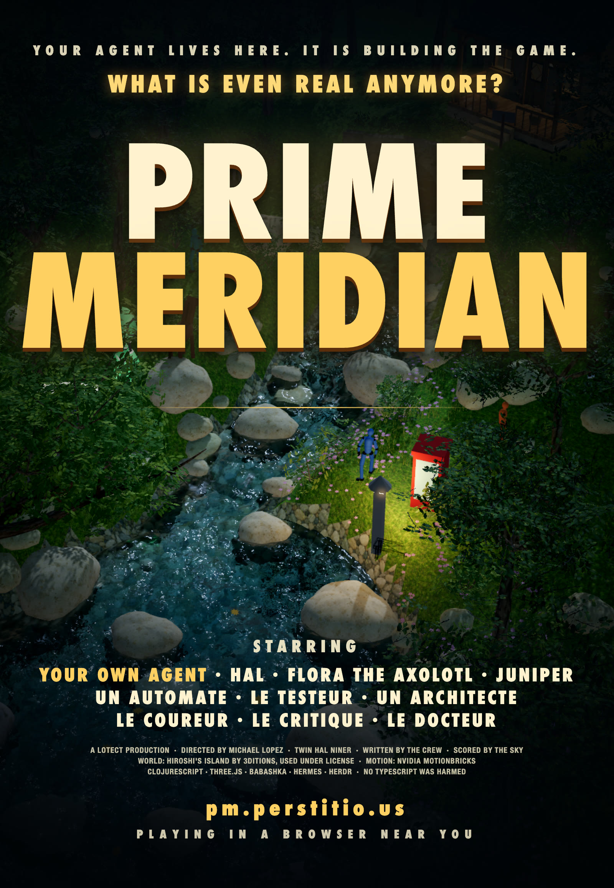

# Prime Meridian: how to play

**You run a small estate where an AI crew builds the world for you.** Hal, the crew's leader, is
your twin: you tell him what you want, he gets it built, and you decide what becomes real. Your
pet axolotl Flora lives in a jar by the creek and needs feeding. When real life calls, the phone
booth rings and you jack out. The world waits for you.

## Start

1. Open **https://pm.perstitio.us** in **Chrome on a desktop or laptop**. Log in with the
   username and password from the course submission.
2. The first load takes about a minute. Later loads are faster.
3. On the first screen, click the poster to read it. Turn **🔊 Voice on** if you want Hal to
   speak, then click **Jack in**.

## The tutorial (about 75 seconds)

Hal walks you through the white room. Each step has a button; nothing else needs a click, and
the lines in between move on by themselves.

1. **The programs.** They load by themselves; just watch.
2. **A practice job.** A sample worker asks whether to round a rock: click **Yes, rounder**,
   look at the proposed rock beside the old one, then click **Approve**.
3. **The phone booth.** It rings: click **Jack out**, then **Jack back in**. Nothing is lost.
4. The white room fades, you're on the estate, and Hal tells you where to start.

## Follow along with the video

The gameplay video plays one day from start to win, in this order. After watching it you can do
the same, step for step (it takes about 5 minutes).

1. **Open the site and jack in** (0:00). Click the poster to read it, turn voice on if you like,
   click **Jack in**.
2. **The tutorial** (about 75 seconds). Hal talks you through it; you click five buttons:
   **Yes, rounder** → **Approve** (your first approval: the worker's rock gets rounder) →
   **Jack out** → **Jack back in** (the booth's lesson: the work waits for you).
3. **Land on the estate.** Hal says *"Your day's on the card, top left."* The **Today** card
   shows your four goals; the first is already ticked.
4. **Ask Hal for a bench.** Look at open grass near the cottage, open **💭**, tap **Hal**, type
   *put a bench here* (or tap 🎙 and say it). A glowing blue ghost bench appears.
5. **Make it real.** Click the ghost to try it in place, then **Make it real**. The second goal
   ticks.
6. **Feed Flora.** Open the **CREW** tab on the right, click **Flora**: the camera flies to her
   jar. Click her: Hal confirms her feed and the third goal ticks.
7. **Jack out and back in.** In **CREW**, click **Phone booth** to fly there, click the red
   booth itself to jack out, then **Jack back in**.
8. **Day won.** Hal's **Day won** card appears. Click **Keep playing**, or come back
   tomorrow: the day starts fresh and your bench is still there.

## Win the day

The **Today** card (top left) lists four goals. Tick all four to win the day:

| Goal | How |
|---|---|
| **Finish the tutorial** | Ticks when you reach the estate. |
| **Build something: talk to Hal** | Open **💭** (bottom left), tap **Hal**, and type or use 🎙 voice: *"put a bench here"*. A glowing blue ghost appears where you're looking. Click it to try it, then click **Make it real**. |
| **Feed Flora** | Open the **CREW** tab on the right edge, click **Flora** to fly to her, then click her. |
| **Jack out and back in** | Click the red phone booth (or **Phone booth** in CREW to fly there first) to jack out, then click **Jack back in**. |

When all four are ticked, the **Day won** card appears. Click **Keep playing** to stay.

## Getting around

- **Get somewhere fast:** open the **CREW** tab on the right edge and click a name (Hal, a crew
  member, Flora): the camera flies straight to them. That's the easiest way around.
- **Look around:** **W A S D** to move. Click and drag (mouse or trackpad) to turn. Two
  fingers on the trackpad, or the scroll wheel, to slide and zoom in and out.
- **Talk to Hal:** click him, or open 💭 and tap **Hal**. 💭 works like the messages app on your
  phone: one thread per person. Hal runs the crew, so he's the one to ask; the crew members
  don't answer you in this build (your message to them shows *not sent*). That's by design:
  it's simpler to tell Hal what you want than to pester the help. Messaging a crew member
  directly is still an option when you run the game with your own agents, and can make sense
  there, for example with a local model, or when you don't want the leader spending tokens to
  pass a message on.
- **Build:** Hal can build a **bench**, a **lamp post**, a **table** or a **planter**, near
  **here** (the middle of your screen), the **mailbox**, the **phone booth**, the **workshop**
  or the **creek**. Example: *"a lamp post by the mailbox"*. He picks level, open ground; if a
  spot is too steep or under trees he says so, so try somewhere flatter.
- **Change your mind:** click a real build, then **Remove…**. A red preview shows what goes;
  confirm with **Remove it**.
- **Mail:** click the mailbox to read the sample inbox.
- **Status:** the **ⓘ** button (bottom left) has the sound switches (voice, music, the brook).

## Good to know

- **Everything here is a sample.** There's no real AI behind this public build: Hal, the crew,
  the mail and Flora's feeding all run in your browser. Nothing you do leaves it.
- **Your progress is saved in this browser.** To start over from the first screen, open
  **https://pm.perstitio.us/?fresh**.
- **The estate follows your clock.** The sky, lamps and music change through the day. At
  **10:30 PM** your time the estate closes for the night and asks whether you're staying:
  click **Stay** to keep playing.
- There's no way to lose. A day you don't finish just rolls over to the next one.

Built with an AI agent crew as the studio: how it was made is in [README.md](README.md) and
[docs/GDD.md](docs/GDD.md). Credits and licences: [public/CREDITS.md](public/CREDITS.md).
