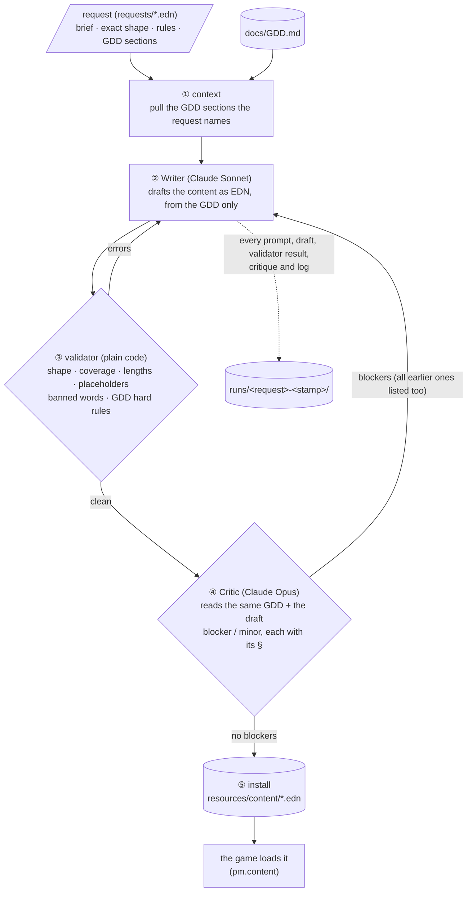

# Content pipeline: Prime Meridian's lines, written from its own GDD

**Game:** **Prime Meridian**, a cozy 3D management game where the characters are
real AI agents doing real work ([`docs/GDD.md`](../docs/GDD.md)).
**Assignment 4:** a pipeline that generates content the game needs, using the
GDD as source material, with a consistency-check loop.

## Run it

```bash
bb content hal-lines          # one request
bb content all                # all three
bb content all --dry-run      # build and save the prompts only, call no model
```

Needs [Babashka](https://babashka.org) and the `claude` CLI logged in. Models:
`WRITER_MODEL` (default `claude-sonnet-5`) and `CRITIC_MODEL` (default
`claude-opus-5-5`). The code is one file, [`pipeline.clj`](pipeline.clj); each
piece of content is one request file in [`requests/`](requests/).

## How it works



1. **Context.** The request names GDD sections (`"2.3"`, `"2.5"`, ...). The
   pipeline cuts exactly those sections out of `docs/GDD.md` (plus any repo
   file, e.g. `resources/estate.edn`) and gives them to both agents. Nothing
   about the game comes from anywhere else.
2. **Writer.** Claude, in print mode with no tools, gets the context, the
   brief, the exact EDN shape and the hard rules, and returns EDN only.
3. **Validator.** Plain code, no model: the shape and every required key,
   3–5 distinct variants each, length limits, placeholders allowed per key,
   and the GDD's hard rules as patterns: no XP, scores or streaks (§1, §2.6),
   no shaming (§3.2), no lines from the films (§1), memorial and virtual
   creatures with no needs and no first-person speech from a pet that died
   (§2.5), pretend addresses only, `:sample true` on every message (§3), and
   no "{count} things" (it reads "1 things").
4. **Critic.** A second, stronger model reads the same GDD sections and the
   draft and returns findings as EDN, each with a severity, the line, the
   issue, the GDD section it rests on, and a fix. Blockers break a GDD fact or
   rule; minors are taste.
5. **Loop.** Validator errors and critic blockers go back to the writer with
   its draft, along with every blocker from earlier drafts so fixed ones don't
   come back. It stops at the request's `:max-drafts` (3 or 5). Only a draft
   that passes both checks is installed. One that never passes is **not**
   installed, and the run fails.
6. **Install.** The winner goes to `resources/content/<name>.edn`, with a
   header naming its run. The game reads those files.

## The three outputs

| Output | What the game uses it for | GDD | File |
|---|---|---|---|
| **Hal's lines** | Hal, the player's digital twin, speaks on 20 events: jack in, coming back, the three kinds of jack-out, chore done, a chore not due yet, a chore taken back, program loaded or needed, the smallest next step, coaching, the morning card, blueprints waiting, a stalled worker, last call, closing time, staying late, a pet moved to memorial, the weekly card | §2.3, §2.6, §2.7, §3 | [`hal-lines.edn`](../resources/content/hal-lines.edn) |
| **Mirror bubbles and signs** | what Flora (axolotl), Juniper (horse) and Biscuit (dog) say and what their jar or hay sign reads; plus memorial plaques, Hal's note when a pet moves to memorial, and virtual creatures' idle lines | §2.5, §3.1 | [`mirror-lines.edn`](../resources/content/mirror-lines.edn) |
| **The pretend inbox** | `me@acme.com`, the mailbox a new player finds on day one in demo mode: Hal's morning card, two blueprints, two questions, two chore notices, Pepper's signature request, the Clerk's triage, and a bait mail the Clerk held back | §3.1, §3.2, §4.6 | [`sample-inbox.edn`](../resources/content/sample-inbox.edn) |

A taste:

- **Hal:** "Time, by your own clock: {bedtime}. Goodnight." · "Alright. You're
  staying. I asked once, that's enough." · "I'm sorry about {name}. Their
  chores are off your list now, and their spot stays theirs."
- **Flora:** "I'm hungry" · "Is it five already?" · sign "Worms left: {stock}"
- **The Clerk** on the bait mail: "Flagged: asks outright for a password and a
  card number; held back before any agent holding keys could read it."

## Does it sound like the game?

**The facts and rules, yes. The voice, partly.** The critic's own one-line
verdict on the installed drafts:

- Hal: "Mostly yes: Hal reads as a companion who shoos you out to real life
  ('not on a screen', 'Time, by your own clock'), but…" it wants more of the
  estate's own words.
- Mirrors: "Mostly: the lines are light, never guilt-trip, and the counts on
  signs stay true, but many are flat and interchangeable."
- Inbox: "Partly: the estate is there (shelves, desks, the worm jar, the front
  office, the reader with no keys) and the facts and guardrails hold, but most
  lines read like a plain work inbox."

So the loop reliably enforces the GDD's facts and guardrails, which is what
the game can't ship without. Taste ("make it wryer, more jack-in shorthand")
is a minor finding by design, so it never blocks.

## What the critic caught

Across 8 runs and 26 drafts the critic raised **38 blockers**. All runs and
their logs are in [`runs/`](runs/). The first three runs installed nothing,
and that's the loop working. The ones that mattered:

**Hal claiming what he can't know** (§3, the twin rule: a twin shows only what
its counterpart's real state says):
- "Nothing here moved while you were gone." But agents keep working while
  you're out, so Hal would be lying about the world.
- "Nothing lost, just paused." about a stalled worker. The bridge doesn't know
  whether its work survived.
- "{program}: live." Every program loads as a pretend version first; calling
  it live passes a sample off as real.
- "10:30. The estate goes quiet." Bedtime is the player's own setting
  (`{:bedtime "22:30"}`, a night-shift nurse closes at 9 am), so the request
  gained a `{bedtime}` placeholder.

**Grief done wrong** (§2.5 memorial rules):
- Hal saying *he* moved a pet to memorial ("I moved {name} to the sunny spot
  for good"). Only the player does that.
- No line saying the pet's chores stopped counting, which the GDD has the twin
  say "kindly and truthfully".
- "Done — {name}'s a memorial now. Nothing to track, just memory." The critic:
  "butler task-confirmation… should not ship for a grief moment."

**Rules of the world:**
- Juniper asking for oats (his only chore is hay; the world can't register
  oats). "I'm famished" escalating past one steady overdue state (§2.3).
- The inbox's Pepper reading a refund request from mail. She holds the
  payment keys, and agents with keys never read raw untrusted mail (§3.2).
- Chore mail from invented "Canal Keeper" and "Porch Keeper" senders. The
  keeper is Hal's errand, not a character (§3).
- A worker's blueprint that changed the game's own canal shader. On a new
  player's estate, workshops are the player's repos (§2.4, §2.8).
- "Flora's been circling the jar this morning." The keeper sees state, not the
  animal.
- A day-one inbox saying "the count you reported" and "like you asked" to a
  player who hasn't done anything yet.
- Clerk counts that didn't add up, and a morning brief that misreported what
  was waiting.

**Bugs a script should catch** (moved into the validator after the critic
found them): "Only {stock} worms left" reads "Only 1 worms left", so a count
followed by a plural noun is now a validator error. It paid off in run 8, when
Hal gained two events for click-to-feed (`:chore-not-due`, `:chore-undone`):
the validator stopped draft 1 on "Morning card's up: {count} items." before
the critic saw it, and draft 2 installed with no blockers. The same check also
flagged "{hours} this week", which is fine English: a false positive the
rewrite happened to avoid.

## What the critic got wrong, and what the validator got wrong

- The validator's first film-line pattern flagged "just the one question"
  (looking for "the One"), and its shaming check flagged "lazy-loading". Both
  patterns were narrowed.
- Its credential check flagged "the bank rocks by the dock" and the Clerk
  *describing* the bait mail. It now looks for "bank account/details" and lets
  the Clerk's summary name what it held back.
- The critic is strict, which costs drafts. Each run is 3–5 Claude calls and
  a few minutes; the logs show every one.

## Where it lives in the game

The crew round [`content-in-game`](../crew/runs/) wires the three files in:
Flora's and Juniper's bubbles and signs come from `mirror-lines.edn` (a
different line each day), Hal greets you from `hal-lines.edn` when you jack in
and after a chore, and the HUD shows the pretend mailbox count. A coverage
test fails the build if a regenerated file drops a key the game uses.

Later rounds the same night (`talk-captions`, `click-chores`, `request-todos`)
made those lines readable and playable: every line shows as a big caption, is
spoken aloud when 🔊 is on, and lands in a 💭 history. Clicking a creature does
its chore, and Hal answers with `:chore-done` or, when it's too early,
`:chore-not-due` ("Last done at 8:16 PM. Not due again till around 8:00 AM.").
A creature's request in the history is a checkbox; unticking it takes the chore
back with a `:chore-undone` line.
