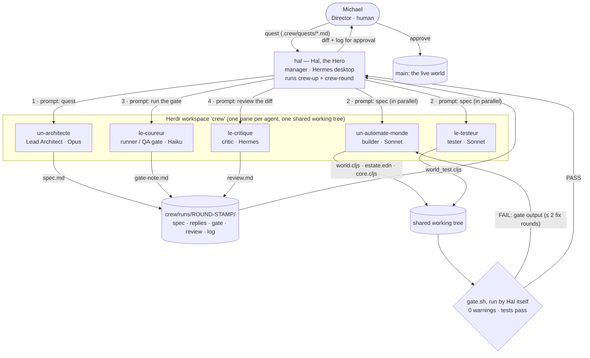

# The crew: agents that build Prime Meridian

**Game:** **Prime Meridian**, a cozy 3D management game where the characters
are real AI agents (design: [`docs/GDD.md`](../docs/GDD.md), crew design §4.2).

**What this crew produces:** game-ready, tested ClojureScript and estate data
for Prime Meridian, one quest at a time, gated by a 0-warning build and a
passing test suite. Its first quest is **the feeding loop for Flora**, the
player's axolotl (GDD §1 "The snap"): mark her fed and the worm jar drops by
one, her "I'm hungry" bubble pops, and the jar's sign warns when worms run
low. The same code also runs a second, unrelated mirror (a horse with a hay
counter), because nothing in the game's code may know what the player's pet
is (GDD §2.5). Output of that round: `resources/estate.edn`,
`src/pm/world.cljs`, `test/pm/world_test.cljs`, the F-key and HUD hook in
`src/pm/core.cljs`, plus the round's spec, gate note and review.

## The crew

**Naming.** French names, after Claude Monet, the manager in
[crew-up](https://github.com/xicubed/crew-up)'s own crew; here the manager is
Hal, the player's twin. The name says what the member does, and its
grammatical gender says where its model runs:

- masculine = a cloud model: `le-` / `un-` (Monsieur, M.);
- feminine = a local model: `la-` / `une-` (Madame, Mme);
- `un-` / `une-` before a vowel, because `l'` would hide which;
- `m-` (M., Monsieur) = a member on a remote open-weight cluster.

Jobs: *architecte* (architect), *automate* (builder; one per area of the
game, e.g. `un-automate-monde` for the world rules, later
`un-automate-rochers`, `une-automate-arbres` on a local model), *testeur*
(tester), *coureur* (runner), *critique* (critic), *docteur* (docs: "doc",
and M.D. = Markdown; the docs are the crew's memory). Herdr names allow only
a-z, 0-9, `-`, `_`, up to 32 characters. Everyone today is masculine: the
whole crew runs on Anthropic's cloud. In-game, each one is a worker in the
estate's workshop (GDD §4.2).

| Herdr name | Crew role | GDD role | Runs on | Writes |
|---|---|---|---|---|
| `hal` | manager | **Hal, the Hero** (the player's twin): takes the Director's quests, leads the crew, merges | Hermes (desktop app), Claude Opus 5.5 | the quest, the commit |
| `un-architecte` | architect | **Lead Architect**: decides how the pieces fit, owns the blueprint | Claude Code, Opus 5.5 | `spec.md`: data shapes, signatures, numbered test cases with hand-checked values |
| `un-automate-monde` | builder | **Gameplay Engineer** for the world rules (`pm.world`); later builders by area: `un-automate-rochers`, `une-automate-arbres`, ... | Claude Code, Sonnet 5 | source files the spec assigns |
| `le-testeur` | tester | **QA Tester** (writes the tests, from the spec, in parallel with the builder) | Claude Code, Sonnet 5 | `test/pm/*_test.cljs` |
| `le-coureur` | runner | **QA gate**: runs the build gate and reports | Claude Code, Haiku 4.5 | `gate-note.md` |
| `le-critique` | critic | **Red-pen review**: purity, "everyone's game" leaks, spec drift | Hermes (own `crew` profile), Sonnet 5 | `review.md` (≤ 5 ranked findings) |
| `le-docteur` | docs *(off for now)* | **Writer** of the crew's memory: `crew/README.md`, session notes | Claude Code, Sonnet 5 | docs the manager names |

The two rounds logged below ran before the builder was renamed, so their logs call it `le-codeur-monde`.

The Director (Michael, the human) approves every change: nothing reaches
`main` (the one live world) until he says so.

## How they coordinate



Data flows down as specs and prompts and comes back up as files: every
agent writes its output to a file the next step reads, and Hal reads each
member's pane to know it finished. Agents never talk to each other directly;
Hal is the hub, which keeps the round reproducible and logged.

**The code.** The crew runs on [crew-up](https://github.com/xicubed/crew-up) (v0.2.0, [`c5e11ab`](https://github.com/xicubed/crew-up/commit/c5e11ab))
(raw orchestration in shell over Herdr's CLI; no framework):

- `crew-up` starts every enabled member of [`.crew/crew.json`](../.crew/crew.json)
  in its own pane with its role card (`.crew/roles/*.md`) and model.
- `crew-round` runs a round file ([`.crew/rounds/feed-flora.json`](../.crew/rounds/feed-flora.json)):
  each step prompts one or more members at once, waits for all of them,
  checks the files they were asked for, runs the gate
  ([`.crew/gate.sh`](../.crew/gate.sh)) itself, sends failures back to the
  builder, and logs everything to `crew/runs/<round>-<stamp>/log.md`.

Why this shape: one shared working tree, because the game has one world;
separate copies per agent would fork it ("a multiverse"). Parallel work stays
safe because each member owns different files (source vs tests), and nothing
goes live until the Director approves the commit.

## Run it

```bash
herdr                                   # once: start Herdr (the panes live here)
cd ~/src/prime-meridian
~/src/crew-up/plugins/crew-up/bin/crew-up                       # start the crew
~/src/crew-up/plugins/crew-up/bin/crew-round .crew/rounds/feed-flora.json
cat crew/runs/feed-flora-*/log.md      # what happened, step by step
bash .crew/gate.sh                     # the same gate, by hand
```

Needs Herdr ≥ 0.9, Claude Code logged in, `jq`, the JDK and Node from
`AGENTS.md`, and for the Hermes members a Hermes profile named `crew`
(see crew-up's README, "Hermes").

## Runs

| Round | Agents | Result | Log |
|---|---|---|---|
| `feed-flora` (Oct 31) | architect → builder ∥ tester → runner + gate → critic | **PASS**: 32 tests, 121 assertions, 0 warnings; F key feeds Flora in the running game. Paused twice at permission dialogs, which Hal answered (logged); resumed with `--run … --from …` | [`log.md`](runs/feed-flora-20261031-1250/log.md) · [spec](runs/feed-flora-20261031-1250/spec.md) · [review](runs/feed-flora-20261031-1250/review.md) |
| `feed-flora-polish` (Oct 31) | builder ∥ tester → runner + gate → critic | **PASS** in one uninterrupted run (1 min 40 s): applied the critic's 4 findings; the critic caught one only half-done, Hal fixed that one line | [`log.md`](runs/feed-flora-polish-20261031-1307/log.md) · [review](runs/feed-flora-polish-20261031-1307/review.md) |
| `mirrors-v0` (Oct 31) | architect → builder ∥ tester → runner + gate → critic | **PASS**: 54 tests, 222 assertions, 0 warnings; Flora, her jar and Juniper placed in the kit's world, labels follow the rules (F: 3/3 → 2/3 labels). One permission pause (logged); the critic flagged Hal's own role-card edit and an empty reply file, both explained/fixed | [`log.md`](runs/mirrors-v0-20261031-1656/log.md) · [spec](runs/mirrors-v0-20261031-1656/spec.md) · [review](runs/mirrors-v0-20261031-1656/review.md) |
