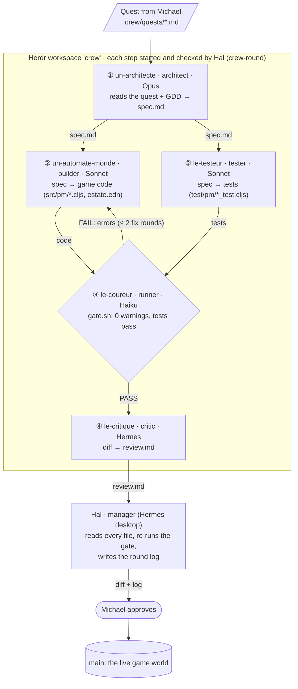

# The crew: agents that build Prime Meridian

**Game:** **Prime Meridian**, a cozy 3D management game where the characters
are real AI agents (design: [`docs/GDD.md`](../docs/GDD.md), crew design §4.2).

**What this crew produces:** game-ready, tested ClojureScript and estate data
for Prime Meridian, one quest at a time, gated by a 0-warning build and a
passing test suite. Its first quest is **the feeding loop for Flora**, the
player's axolotl (GDD §1 "The snap"): mark her fed and the worm jar drops by
one, her "I'm hungry" bubble pops, and the jar's sign warns when worms run
low. The same code also runs a second, unrelated mirror (a horse with a hay
counter), because nothing in the game's code may know what the player's pet
is (GDD §2.5). Output of that round: `resources/estate.edn`,
`src/pm/world.cljs`, `test/pm/world_test.cljs`, the F-key and HUD hook in
`src/pm/core.cljs`, plus the round's spec, gate note and review.

> **Use it in your own project.** The crew machinery isn't specific to this
> game: it's [**crew-up**](https://github.com/xicubed/crew-up), an MIT-licensed
> Claude Code plugin (also usable from Hermes or any agent that can drive
> [Herdr](https://herdr.dev)). Install it, run `/crew-setup` to pick your roster,
> add a gate script and a quest, and `crew-round` runs the same
> architect → builder ∥ tester → gate → critic loop on your code. This folder
> and [`.crew/`](../.crew/) are a working example of one project's setup.

## The crew

**Naming.** French names, after Claude Monet, the manager in
[crew-up](https://github.com/xicubed/crew-up)'s own crew; here the manager is
Hal, the player's twin. The name says what the member does, and its
grammatical gender says where its model runs:

- masculine = a cloud model: `le-` / `un-` (Monsieur, M.);
- feminine = a local model: `la-` / `une-` (Madame, Mme);
- `un-` / `une-` before a vowel, because `l'` would hide which;
- `m-` (M., Monsieur) = a member on a remote open-weight cluster.

Jobs: *architecte* (architect), *automate* (builder; one per area of the
game, e.g. `un-automate-monde` for the world rules, later
`un-automate-rochers`, `une-automate-arbres` on a local model), *testeur*
(tester), *coureur* (runner), *critique* (critic), *docteur* (docs: "doc",
and M.D. = Markdown; the docs are the crew's memory). Herdr names allow only
a-z, 0-9, `-`, `_`, up to 32 characters. Everyone today is masculine: the
whole crew runs on Anthropic's cloud. In-game, each one is a worker in the
estate's workshop (GDD §4.2).

| Herdr name | Crew role | GDD role | Runs on | Writes |
|---|---|---|---|---|
| `hal` | manager | **Hal, the Hero** (the player's twin): takes the Director's quests, leads the crew, merges | Hermes (desktop app), Claude Opus 5.5 | the quest, the commit |
| `un-architecte` | architect | **Lead Architect**: decides how the pieces fit, owns the blueprint | Claude Code, Opus 5.5 | `spec.md`: data shapes, signatures, numbered test cases with hand-checked values |
| `un-automate-monde` | builder | **Gameplay Engineer** for the world rules (`pm.world`); later builders by area: `un-automate-rochers`, `une-automate-arbres`, ... | Claude Code, Sonnet 5 | source files the spec assigns |
| `le-testeur` | tester | **QA Tester** (writes the tests, from the spec, in parallel with the builder) | Claude Code, Sonnet 5 | `test/pm/*_test.cljs` |
| `le-coureur` | runner | **QA gate**: runs the build gate and reports | Claude Code, Haiku 4.5 | `gate-note.md` |
| `le-critique` | critic | **Red-pen review**: purity, "everyone's game" leaks, spec drift | Hermes (own `crew` profile), Sonnet 5 | `review.md` (≤ 5 ranked findings) |
| `le-docteur` | docs *(off for now)* | **Writer** of the crew's memory: `crew/README.md`, session notes | Claude Code, Sonnet 5 | docs the manager names |

The two rounds logged below ran before the builder was renamed, so their logs call it `le-codeur-monde`.

The Director (Michael, the human) approves every change: nothing reaches
`main` (the one live world) until he says so.

## How they coordinate



Data flows down as specs and prompts and comes back up as files: every
agent writes its output to a file the next step reads, and Hal reads each
member's pane to know it finished. Agents never talk to each other directly;
Hal is the hub, which keeps the round reproducible and logged.

**The code.** The crew runs on [crew-up](https://github.com/xicubed/crew-up) (v0.2.1, [`a31137e`](https://github.com/xicubed/crew-up/commit/a31137e))
(raw orchestration in shell over Herdr's CLI; no framework):

- `crew-up` starts every enabled member of [`.crew/crew.json`](../.crew/crew.json)
  in its own pane with its role card (`.crew/roles/*.md`) and model.
- `crew-round` runs a round file ([`.crew/rounds/feed-flora.json`](../.crew/rounds/feed-flora.json)):
  each step prompts one or more members at once, waits for all of them,
  checks the files they were asked for, runs the gate
  ([`.crew/gate.sh`](../.crew/gate.sh)) itself, sends failures back to the
  builder, and logs everything to `crew/runs/<round>-<stamp>/log.md`.

Why this shape: one shared working tree, because the game has one world;
separate copies per agent would fork it ("a multiverse"). Parallel work stays
safe because each member owns different files (source vs tests), and nothing
goes live until the Director approves the commit.

## Run it

### Coming back the next day

The crew lives in Herdr panes, so bring Herdr up first, then the crew:

1. **Start Herdr** in a terminal: `herdr`, then detach with `Ctrl+Space d`
   (it keeps running in the background). If Herdr never stopped, yesterday's
   panes are still there, and step 2 skips members already running.
2. **Either tell Hal** in the Hermes desktop chat: "bring up the crew" (or
   just give him the next quest; he starts the crew if it isn't up), **or do
   it by hand**:

```bash
cd ~/src/prime-meridian
~/src/crew-up/plugins/crew-up/bin/crew-up              # start every enabled member of .crew/crew.json
~/src/crew-up/plugins/crew-up/bin/crew-up --only le-critique   # or just some of them
```

   crew-up also starts the crew's **services** from `.crew/crew.json`: today
   `bb crew-status`, which writes each member's Herdr state to the gitignored
   `public/state/crew.edn`, so the coloured dots over the walkers on the
   estate stay live (it runs in the crew workspace's `services` tab).

3. **Run a round** (Hal normally does this, and answers the members'
   permission prompts):

```bash
~/src/crew-up/plugins/crew-up/bin/crew-round .crew/rounds/feed-flora.json
cat crew/runs/feed-flora-*/log.md      # what happened, step by step
bash .crew/gate.sh                     # the same gate, by hand
```

A new piece of work is a quest (`.crew/quests/<name>.md`) plus a round file
(`.crew/rounds/<name>.json`, copy an existing one). Nothing the crew does is
committed until Hal reviews it and Michael approves.

**To stop:** close the `crew` workspace in Herdr (or quit Herdr). Members
don't carry memory between restarts; each one rereads its role card, and the
round's spec and log are in `crew/runs/`.

Needs Herdr ≥ 0.9, Claude Code logged in, `jq`, the JDK and Node from
`AGENTS.md`, a clone of [crew-up](https://github.com/xicubed/crew-up) at
`~/src/crew-up` (`git pull` it to update), and for the Hermes members a
Hermes profile named `crew` (see crew-up's README, "Hermes").

## Runs

| Round | Agents | Result | Log |
|---|---|---|---|
| `feed-flora` (Oct 31) | architect → builder ∥ tester → runner + gate → critic | **PASS**: 32 tests, 121 assertions, 0 warnings; F key feeds Flora in the running game. Paused twice at permission dialogs, which Hal answered (logged); resumed with `--run … --from …` | [`log.md`](runs/feed-flora-20261031-1250/log.md) · [spec](runs/feed-flora-20261031-1250/spec.md) · [review](runs/feed-flora-20261031-1250/review.md) |
| `feed-flora-polish` (Oct 31) | builder ∥ tester → runner + gate → critic | **PASS** in one uninterrupted run (1 min 40 s): applied the critic's 4 findings; the critic caught one only half-done, Hal fixed that one line | [`log.md`](runs/feed-flora-polish-20261031-1307/log.md) · [review](runs/feed-flora-polish-20261031-1307/review.md) |
| `mirrors-v0` (Oct 31) | architect → builder ∥ tester → runner + gate → critic | **PASS**: 54 tests, 222 assertions, 0 warnings; Flora, her jar and Juniper placed in the kit's world, labels follow the rules (F: 3/3 → 2/3 labels). One permission pause (logged); the critic flagged Hal's own role-card edit and an empty reply file, both explained/fixed | [`log.md`](runs/mirrors-v0-20261031-1656/log.md) · [spec](runs/mirrors-v0-20261031-1656/spec.md) · [review](runs/mirrors-v0-20261031-1656/review.md) |
| `mirrors-v1-looks` (Oct 31) | architect → builder ∥ tester → runner + gate → critic | **PASS** with no stops: 66 tests, 305 assertions, 0 warnings; looks as data, Flora an axolotl of 15 parts, Juniper a horse of 13. The critic found nothing to rank; Hal's screenshot check turned Flora side-on and above the water (data only, logged) | [`log.md`](runs/mirrors-v1-looks-20261031-2051/log.md) · [spec](runs/mirrors-v1-looks-20261031-2051/spec.md) · [review](runs/mirrors-v1-looks-20261031-2051/review.md) · [screenshot](runs/mirrors-v1-looks-20261031-2051/flora-creek.png) |
| `real-state-v0` (Nov 6) | architect → builder ∥ tester → runner + gate → critic | **PASS**: 84 tests; the game reads Flora's real state from a private file Hal keeps, and follows edits within 5 s | [`log.md`](runs/real-state-v0-20261106-1739/log.md) · [spec](runs/real-state-v0-20261106-1739/spec.md) · [review](runs/real-state-v0-20261106-1739/review.md) |
| `real-state-v1-cache` (Nov 6) | architect → builder ∥ tester → runner + gate → critic | **PASS**: 97 tests, 488 assertions; the game remembers Hal's last state, so it stays right while Hal is offline | [`log.md`](runs/real-state-v1-cache-20261106-1749/log.md) · [spec](runs/real-state-v1-cache-20261106-1749/spec.md) · [review](runs/real-state-v1-cache-20261106-1749/review.md) |
| `content-in-game` (Nov 6) | architect → builder ∥ tester → runner + gate → critic | **PASS** with no stops: 125 tests; the content pipeline's output in the game (Hal's lines, Flora's and Juniper's bubbles, the sample inbox) and a coverage test that fails if regenerated content drops a key the game uses | [`log.md`](runs/content-in-game-20261106-1852/log.md) · [spec](runs/content-in-game-20261106-1852/spec.md) · [review](runs/content-in-game-20261106-1852/review.md) |
| `talk-captions` (Nov 6) | architect → builder ∥ tester → runner + gate → critic | **PASS** with no stops: 151 tests; big captions, a 🔊 voice (the browser's own speech) and a 💭 history you can scroll. Hal's follow-ups from Michael's play-testing (logged): voice remembered, no repeats on reload, keys kept from the kit (H hid its menu), sample feedings survive a reload, each line spoken once | [`log.md`](runs/talk-captions-20261106-1946/log.md) · [spec](runs/talk-captions-20261106-1946/spec.md) · [review](runs/talk-captions-20261106-1946/review.md) |
| `click-chores` (Nov 6) | architect → builder ∥ tester → runner + gate → critic | **PASS**: 179 tests; click a creature to do its chore, Hal says when it's not due yet, undo/redo, F/G keys gone. Stopped at build on three read-only prompts (approved), resumed `--from gate` | [`log.md`](runs/click-chores-20261106-2034/log.md) · [spec](runs/click-chores-20261106-2034/spec.md) · [review](runs/click-chores-20261106-2034/review.md) |
| `request-todos` (Nov 6) | architect → builder ∥ tester → runner + gate → critic | **PASS**: 202 tests; the creature's request in 💭 is a checkbox (tick = feed, untick = undo). Stopped at spec and build on prompts; Michael put the builder in auto mode; resumed twice | [`log.md`](runs/request-todos-20261106-2102/log.md) · [spec](runs/request-todos-20261106-2102/spec.md) · [review](runs/request-todos-20261106-2102/review.md) |
| `motion-bricks-v0` (Nov 7) | architect → builder ∥ tester → runner + gate → critic | **PASS** with no stops: 260 tests; two crew walkers pace the creek bank, and with `?bricks` their walking is generated live by NVIDIA MotionBricks (vendored `three-motionbricks`, one shared model, ~60 fps, 220-280 ms per generation); simple figures otherwise or on any failure | [`log.md`](runs/motion-bricks-v0-20261107-1211/log.md) · [spec](runs/motion-bricks-v0-20261107-1211/spec.md) · [review](runs/motion-bricks-v0-20261107-1211/review.md) · [screenshot](runs/motion-bricks-v0-20261107-1211/walkers-above.jpg) |
| `avoid-v0` (Nov 7) | architect → builder ∥ tester → runner + gate → critic | **PASS**: 325 tests; walkers look 2 s ahead and step around each other (both keep right), Juniper's body and the rocks; `?paths` draws it. Michael: "he did like a little jig to get by", "he went around a rock" | [`log.md`](runs/avoid-v0-20261107-1327/log.md) · [spec](runs/avoid-v0-20261107-1327/spec.md) · [review](runs/avoid-v0-20261107-1327/review.md) |
| `characters-v0` (Nov 7) | architect → builder ∥ tester → runner + gate → critic | **PASS**: 353 tests; MotionBricks retargeted onto CC0 Mixamo-rigged avatars (100 Avatars), per-walker fallback; Michael then put Le Testeur back on the mannequin (the chibi avatars scale up to human leg length) | [`log.md`](runs/characters-v0-20261107-1354/log.md) · [spec](runs/characters-v0-20261107-1354/spec.md) · [review](runs/characters-v0-20261107-1354/review.md) |
| `foot-ik-v0` (Nov 7) | architect → builder ∥ tester → runner + gate → critic | **PASS**: 397 tests; two-bone foot IK on the slope, pelvis drop, planted feet tilt with the ground, height from the feet (no more hop), detours stay on walkable ground; `?feet` markers | [`log.md`](runs/foot-ik-v0-20261107-1449/log.md) · [spec](runs/foot-ik-v0-20261107-1449/spec.md) · [review](runs/foot-ik-v0-20261107-1449/review.md) |
| `senses-v0` (Nov 7) | architect → builder ∥ tester → runner + gate → critic | **PASS**: 440 tests; walkers only react to who they see (8 m, ±55°) or hear (1.2 m, more if fast), after 0.4 s, so the one behind does the overtaking; a test name with a dot failed the gate once and the fix round renamed it | [`log.md`](runs/senses-v0-20261107-1553/log.md) · [spec](runs/senses-v0-20261107-1553/spec.md) · [review](runs/senses-v0-20261107-1553/review.md) |
| `crew-dots-v0` (Nov 7) | architect → builder ∥ tester → runner + gate → critic | **PASS**: 468 tests; a dot before each walker's name in its real Herdr state's colour (working amber, blocked red and pulsing, done green, idle grey; hollow when stale), from `bb crew-status` → `public/state/crew.edn` (gitignored). First slice of W3-0 | [`log.md`](runs/crew-dots-v0-20261107-1621/log.md) · [spec](runs/crew-dots-v0-20261107-1621/spec.md) · [review](runs/crew-dots-v0-20261107-1621/review.md) |

Screenshots in `crew/runs/` show the game running on [Hiroshi's Island](https://3ditions.drop3.app/watch/hiroshis-island/) by 3DITIONS (Pixel Palms / Cocotofy LLC), used under license; the kit itself is not in this repo.
