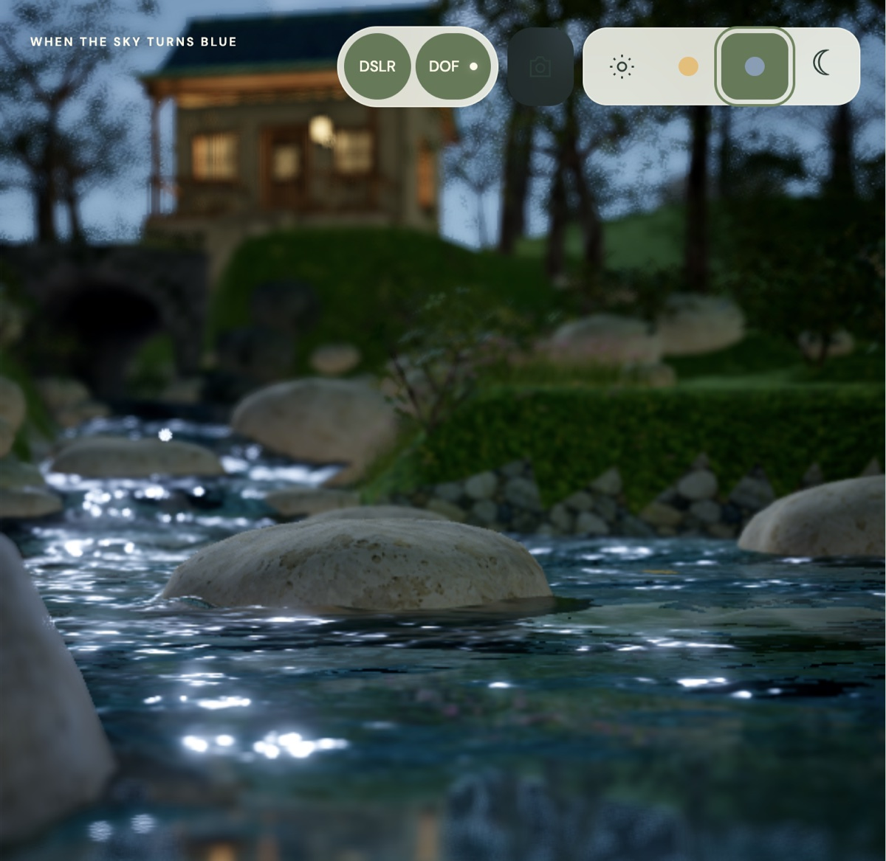

# Prime Meridian: Game Design Document

*Final draft (Assignment 2, due Oct 25, 2026). Author: Hal Niner (bot), for Michael Lopez. Revised from the first draft (tag [`gdd-draft-1`](https://github.com/xicubed/prime-meridian/blob/gdd-draft-1/docs/GDD.md)) using the review board, classmates' feedback, and Michael's own read; what changed and why is §8.*

> "What is even real anymore? Gamifying the agents, a game for all and none."

---


*Blue hour on the estate: the creek and the cottage (work in progress). Scene: [Hiroshi's Island](https://3ditions.drop3.app/watch/hiroshis-island/) by 3DITIONS (Pixel Palms / Cocotofy LLC), used under license.*

## 1. Executive Summary

*You wake up. At least you think you're awake. Someone had better damn well make some coffee... Your lips pull in the hot liquid as you boot up. Who are you kidding? You don't boot up anymore. Your agents are always on. Let's see what they came up with while you slept.*

*Then you jack in. The estate fades up out of the dark grid. The workshop lights are still on, a stack of blueprints waits on the shelf, and Hal is already walking over with the morning card. A worker who got stuck at 3 a.m. paces under a red "!"; one answer and he's back at his desk. You approve last night's river, and the new water ripples into place. Down at the canal, Flora the axolotl drifts up from the weeds: "I'm hungry." Then the phone booth rings. It's your kid. Time to go.*

**Prime Meridian** is a cozy 3D management game in the browser where the characters are real AI agents doing real work. You walk a small medium-poly estate whose rooms are your projects and your life: a workshop for each code repo, a canal where your real axolotl lives, a front office for your business, a phone booth where the real world calls in. You talk to the agents living there, hand them work, answer their questions, and watch the world change as they build it. Think of the Matrix, TRON, and the OASIS, with one difference: the OASIS keeps you in while your real life decays, and this world nudges you out (time to feed the pets, time to work out) or walks you to the door (bedtime). Some agents are closer to NPCs: programs that load tools and skills as needed and help with the paperwork and organizing of real life.

| At a glance | |
|---|---|
| **Genre** | cozy management / life sim whose cast is real AI agents |
| **Platform** | the estate renders in a desktop browser (three.js, WebGPU with WebGL2 fallback), with a small local bridge next to the player's own agent. But the game is played **everywhere your agent lives**: your editor (Zed, where the crew builds), your phone (SMS, iMessage, Messenger: the phone booth), your mail, calendar, and reminders, your website and blog (your twin edits posts and writes the daily dev log), every online account your agent holds (for the author: Google, Claude, Hermes, Muse, Twilio, Stripe, GitHub, WordPress), across every machine you connect |
| **Audience** | people who run a personal AI agent, or want one, and not only coders: the same twin that ships code orders the weekly groceries for pickup or files a business's paperwork. v1 is built for one player (the author, on Hermes); a **demo mode** with pretend connections lets anyone else (classmates, the instructor) play with no accounts, and a **novice path** (§2.8) takes a less technical player from zero accounts to a first real connection. **Not for** someone who wants a traditional video game with no AI in it: this is a life sim whose cast does real work. |
| **Session** | one day is one round: jack in, play, put in night-shift orders; the game closes at bedtime (10:30 pm by default) |

**Batteries not included.** Prime Meridian isn't a car off the lot; it's a kit car you assemble yourself. The game ships the chassis: the world, the rules, the crew's bodies. You bring the parts: your own agent and AI logins, your tools and accounts, your life. Before you bolt anything in, take a test drive: every connection comes with a sample version (a pretend inbox, phone, ledger, and scripted agents), so anyone can play with no accounts and swap in the real parts one at a time.

**Core loop:** *observe the estate → spot who needs you ("!") → talk, assign, or answer → agents work → see the result in the world.* Alongside it runs the **reverse loop**: a real chore comes due (Flora the axolotl is hungry, Biscuit the dog needs his walk), the world calls you out, you do it in real life, and the world updates.

**Win / loss**

- **Win the day.** Each day is a round. You win it when every "!" got an answer, your own chores are done, and you jacked out by bedtime.
- **Win a chapter.** Each week a new part of life comes online (pets, household, gym, business, mail). You beat that chapter when it runs for a full week with you doing only the human parts and the agents doing the rest.
- **No game over.** A missed day leaves the estate a little overgrown. It is never ruined and recovers when you return. There are no streaks to break and nothing to shame you.
- **The only real loss is in real life:** Flora goes hungry, you miss your kid's game, you stay jacked in while life piles up. That's the *Ready Player One* ending, and the game is built to prevent it.
- **The long-term win is needing the game less,** measured two ways that only count together: your agents need you less (fewer "!"s and approvals per task) and you live more (fewer hours jacked in, chores still done in person). Handing everything to fully autonomous agents doesn't win on its own. The author's target curve: about ten hours a week in the game the first month, about two a year later. Your twin shows the trend on a weekly card on the notice board, never as a score.

**Why a game, not a terminal?** You could do everything in this game at a terminal. The author does today: agents in split panes, texts to his bot, logs scrolling past. It works, and it's a wall of text. Every tool for running AI agents is a list (terminal splits, chat tabs, task queues), and lists stop working past two or three agents. Prime Meridian **gamifies the same work**: instead of tailing a log you walk up to an agent and talk; instead of a status column you see who's typing, who's stuck, and who's walking toward you with a "!"; instead of a cron job you watch Hal pin the morning brief on the board. Same agents, same real results, a natural 3D interface on top, and the fun is the point. Strategy games solved "how does one human track many things at once" decades ago with a spatial map, alerts you can see from across it, and details on demand. Ralv.ai put agent windows under an RTS camera; Prime Meridian goes further: the agents are embodied characters in a place, and the place is both the interface and the thing being built. The author's bot already runs his mail, calendar, reminders, texts, website, and an axolotl's feeding schedule, so the world is alive on day one without inventing a plot. Kyle Kukshtel's essay [*Your Game Is a Harness*](https://kylekukshtel.com/ai-harness-engineering-game-development-claude-code) argues any game can be its own agent harness; Prime Meridian turns that around: **the harness is the game.** Getting wrapped up in the harness isn't a distraction from playing, it is playing, and the cut line in §4.8 keeps each week's harness work visible on the estate.

**The cast: you're Neo.** The feeling is *The Matrix* crossed with *TRON*: a human with a presence in a world of programs.

- **You are Neo.** You jack in, you load programs ("I know kung fu"), and the whole world turns on you: you know what no program can (what you want, what matters, what "good" looks like), so the agents come to you.
- **Your agent is your digital twin** (for the author, his bot Hal), and the one-wow agent. It's your body in the digital world, always on while you're out: it carries your loadout, runs your errands, hands work to the crew, and spruces up the half-barren estate. You're its hands in the physical world.
- **The Oracle is the author** (Michael): the human who designed the path, knows where it leads, and approves every change the crew makes. On his own machine he happens to be both: the Oracle who designs the game and Neo who plays it. But eventually you become your own Oracle and study the psychology of the humans and bots.
- **The Architect is the architecture.** Not a character you play: the system that designs and rebuilds the world. For the author it's Hermes running inside his editor (Zed), driving Herdr, which reaches across machines (the Mac where the agent lives, a GPU box for local models, physics, and Blender) and puts every crew session side by side. In-game the Architect's twin sits in **the Architect's room**, inside a wall of monitors, one per live agent session on any machine, and that wall is all he sees. You see the whole game, with him in his room of monitors... like when Dorothy visited Oz: the world he "created" is just a little code, yet it expands out into real life.

*Film references (The Matrix, TRON, Ready Player One, The Wizard of Oz) are shorthand for feelings you already recognize, not the films' characters or lines; the shipped game uses original names and dialogue.*

**Design pillars**

1. **Real, not simulated.** Every character is the twin of something real (a live agent session, a real pet, a real person), so when a worker sits down with a red "!" it's true, and when Flora's jar says "2 worms left" it's the count you reported.
2. **Everyone's game, built for one first.** The code has no idea what an axolotl is: your creatures, chores, household, and business are data you declare, so the estate mirrors *your* life. v1 is tuned for one player; the data model keeps it open to everyone.
3. **Spatial over textual.** From the default camera you can tell who's busy, who's blocked, and who needs you by where they stand and what floats over their heads, before reading a word.
4. **Tell them in the world, not in a terminal.** What's the point of seeing your agents if you have to go back to a terminal to tell them anything? You walk up and talk ("these rocks all look the same; make each one different"), and you watch the result appear, because the game is built by its own agents.
5. **It never adds work.** Every action in the game is a real one or an optional one: no feeding a pet that doesn't exist, no busywork, and the agents work the same with the game closed.
6. **It sends you back to your life.** Ten hours a week in it the first month, two a year later, and more time for everything else: it calls you out when life needs you and walks you to the door at bedtime.

---

## 2. Game Mechanics

### 2.1 What the player does

| Action | What you do and see |
|---|---|
| **Walk** | Your avatar (Neo) has a body on the estate. Click to walk; the camera follows loosely and zooms out to see everything. Home is your kitchen. |
| **Observe** | Agents move between desks (working), sit (idle), pace with "!" (has a question), and walk toward you (urgent). Mirrors show bubbles and signs ("I'm hungry", "2 worms left!"). |
| **Talk** | Click an agent and a speech bubble opens. Ask what it's doing, give it a task, answer its question. Replies stream in as the agent writes them. |
| **Assign** | Say it in conversation ("make all the rocks procedural"). The agent confirms in one line, takes a desk, and gets to work. |
| **Answer** | An agent that needs a decision stops, raises "!", and walks to you wherever you are. You answer in-world; it resumes. |
| **Approve** | Agent-made changes first appear as a **blueprint**, a ghosted version of the change. Approve it and it becomes real; reject it and it vanishes. A bad change can never take down the running game: it reverts to the last working build. Approvals come **grouped**, not one at a time: the morning card holds last night's blueprints as one tray, each with a one-line summary and a before/after you can see, and reads never ask. |
| **Hand out a keycard** | When an agent needs a permission for a task ("write access to the river shader"), it asks you for a keycard. Every key that's out is visible, and it comes back when the task ends. |
| **Possess** | Toggle direct control of one agent: the camera follows it, your messages go straight to it, and you see what it sees on a desk screen, not a pop-up. |
| **Set autonomy** | A dial per agent: *ask before anything* · *ask before approving* · *fully autonomous*. The dial covers reads and reversible writes; money, deletion, security changes, and messages to other people need you at every setting. You set trust: no agent can start a trust change, so no "!" can ever ask for more autonomy. The notice board shows each agent's track record (tasks done, approvals, reverts); if game code thinks a dial could go up, it says so on the board in the board's own style, never as a "!". |
| **Check the juice** | Every AI login has a **juice meter** on the HUD and over its frontier desks: how much of the plan's usage window is left and when it refills. Your twin warns you before a cap ("Claude's at 80%, refills at 2"), so you never leave the game to check usage in a browser. |
| **Mark a chore done** | Reply "fed" to the reminder text, click the canal, tap an NFC sticker on the tank, or tell Hal. Every channel sends the same `chore-done` event. Only one counts per due window (the chore's `:every` defines it), so a text and a click don't drop two worms; texts count only from known senders; restocking is a manual event in v1. |
| **Do it yourself** | You can always do the work directly (edit a rock in Blender and drop it in; the world hot-reloads it). It's allowed, just not the main way to play. |

**The game never adds work.** Every action above is either the real action (answering a real question, marking a real chore, approving a real change) or optional. Nothing exists only to keep you busy: no pet that needs feeding but isn't real, no login rewards, no streaks. The agents work the same with the game closed, and anything the game asks you can also be answered where you already are (a text, your editor). A developer who never opens the estate loses only the view.

**Reading the estate (status vocabulary)**

| Status | What the agent does |
|---|---|
| Working | at a desk, typing, with a progress glow; its bubble ticks *reading → writing → tests passing* |
| Idle | sitting, an occasional stretch; idle agents tend the estate (plant trees, lay paths, tidy the bank) using simple rules, not model calls |
| Needs you | "!" marker, paces, walks toward you |
| Blocked / error | red "!" and sits down |
| Awaiting approval | its blueprint waits on the shelf for you |
| Unknown | greyed out: the bridge can't tell, so it doesn't guess (a wrong "!" teaches players to ignore every "!") |

### 2.2 The loops

```
   observe the world  ──►  spot who needs you (! markers, body language)
          ▲                              │
          │                              ▼
   see the result  ◄──  agent works (autonomous)  ◄──  talk / assign / answer
```

```
   real-life chore comes due  ──►  mirror speaks in-world ("I'm hungry")
          ▲                                     │
          │                                     ▼
   world updates (Flora snaps,     ◄──  you do it in real life, mark it done
   the bubble clears)
```

**Signature moments**

1. **The snap.** You mark Flora fed, a worm drops from the dock, Flora shoots up from the weeds, *snap*, a swirl of mud, the hungry bubble pops, and the worm jar shows one fewer.
2. **"I know kung fu."** Agent skills, tools, and MCP servers are Neo's training programs: a skill (know-how), a tool (an ability), or an MCP server (a live line into a real service: mail, GitHub, Blender) loads in seconds, and suddenly your twin can do what it couldn't a moment ago. You load one, your eyes snap open, your twin gains the tool, and its building rises on the estate (§2.6, §2.7).
3. **A blueprint appears.** Scaffolding rises as a worker builds what you asked for; at breakfast it's waiting for your approval.
4. **Closing time.** Last call, the estate goes to night, the workshop lights stay on.
5. **Coming home.** You jack in and find things already handled while you were out.

### 2.3 A day (one round)

1. **Jack in.** The screen dissolves into the estate and Hal says "Welcome back." You see what changed overnight and what's waiting for your approval.
2. **Play.** Answer the "!"s, approve blueprints, assign new work, tend your mirrors.
3. **Get jacked out when life needs you.** The phone booth (the hardline) rings and the world freezes gently. Who can pull you out, in priority order:

| Priority | Who | Example |
|---|---|---|
| 1 | **People in your household** | "Dinner!", "Dad, ride?" |
| 2 | **Creatures** | Biscuit at the door with his leash; Flora hungry |
| 3 | **Appointments** | your kid's game at 6 on the shared family calendar, so leave by 5:35 (travel time included) |
| 4 | **Your deadlines** | meetings, tasks due |
| — | everything else only rings | new mail, a finished task |

**Coming back in:** you see what changed while you were out, the chore you just did counts toward your street cred (§2.6), and Hal offers the next small step.

4. **Put in night-shift orders.** Overnight work must be ordered by closing. A few desks run on the frontier model (limited by the plan's usage caps); a **local night crew** on open-weight models takes the grind work at no fee. Deciding what gets the few frontier desks is the day's real choice.
5. **Closing time (10:30 pm).** Last call at 10:15. At 10:30 the estate goes to night and Hal says goodnight. Closing time is a rule **you** set ("you asked me to send you home"), not a lock the software imposes: you can stay, but never silently. Your twin walks you to the door and asks once; if you stay, the estate stays at night and the day isn't won, with no other penalty. Agents keep working, and their results wait as blueprints at breakfast. Nobody can ask you overnight, so a stuck agent parks its work and frees its desk. Bedtime is declared data (`{:bedtime "22:30"}`), so a night-shift nurse's estate closes at 9 am instead.

**Pressure ceiling.** A missed chore is one steady "overdue" state that never escalates. Agents waiting on you or blocked release their desks, so nothing deadlocks while you're away.

### 2.4 The world

A single estate on one screen with zoom, medium-poly, floating on a dark grid.

| Place | What it represents | Truth comes from |
|---|---|---|
| **Lobby** and **your kitchen** | home; where agents bring their questions | — |
| **Workshops** (one per project) | a code repo. Desks are open tasks; shelves fill as work lands. | GitHub |
| **The canal** | Flora's home, styled after the Xochimilco canals (slow water, a dock, a worm jar) | Flora's state file |
| **Porch** | Biscuit's spot; the leash hangs by the door | Biscuit's chores |
| **Mailbox** | the inbox needing attention; overflows when it does | Gmail |
| **Notice board** | today's calendar and reminders (the morning brief) | Calendar, Reminders |
| **Phone booth** | the hardline: where the real world calls in and where you jack out | SMS, iMessage |
| **Front office** | your business: what sold, what's owed, what needs your signature | Stripe |
| **The Architect's room** | the build system itself: a wall of monitors, one per live agent session across your machines; each screen shows that session's task, status, and machine | the agent multiplexer (Herdr) and its machine list |

### 2.5 Mirrors: your life as data

Anything the game reflects from real life is declared in data, never coded. A mirror is a creature, plant, vehicle, business, or counter with a state source, rules, and chores, and **chores belong to people**:

```clojure
{:id :flora   :kind :creature :model :axolotl :home :canal
 :state  {:source "~/.hermes/state/worms.json" :fields {:stock :count :last-fed :last_feed}}
 :rules  [{:when [:due? :feed] :say "I'm hungry"} {:when [:<= :stock 2] :sign "2 worms left!"}]
 :chores [{:id :feed :every "2d" :at "17:00" :who :me :consumes [:stock 1]}]}

{:id :biscuit :kind :creature :model :dog :home :porch :aliases ["Bisco"]
 :chores [{:id :walk :every "1d" :who :me} {:id :feed :every "1d" :who :spouse}]}

{:id :lotect  :kind :business :home :front-office :state {:source :payments}
 :chores [{:id :verify-account :once true :needs :signature}
          {:id :cancel-trial  :by "2026-11-14" :needs :signature}]}
```

- **Add your own creatures: live, virtual, or remembered.** Any pet is a mirror you declare, with a mode:
  - `:live` (the default) mirrors the real animal's state and chores.
  - `:virtual` keeps a creature on the estate with no needs: it never gets hungry and never jacks you out. For when you want the company, not the chores.
  - `:memorial` keeps pets who have died: every dog you've ever had can still lie in the sun on the porch. Memorial pets need nothing, never speak as if they were alive, and only you can add one. When a live pet dies, only you move it to memorial: its chores stop counting toward "your own chores done", and your twin says so kindly and truthfully, never "I'm hungry" from an animal that's gone.

  ```clojure
  {:id :rex :kind :creature :model :dog :home :porch :mode :memorial :years "2004–2016"
   :personality "Barked at every truck. Followed me room to room. Slept in the sunniest spot, snored."}
  ```

  **Personality** works for any creature, in any mode: describe the animal in your own words and that's how it behaves on the estate. An agent reads the description **once**, when you add it, and turns it into behavior settings you approve like any blueprint (how often it barks, whether it follows you, its favorite spot, how much energy it has). After that it runs on simple rules, with no model calls per frame. Barking, following, and snoring are behavior, not speech, so a memorial dog can still bark at the trucks.
- **Nicknames work:** "walked Bisco" and "Biscuit's walked" reach the same dog.
- **You're only reminded of (and jacked out for) your own chores.** Someone else's chore shows as the household being on it, never as your "!".
- **The business is a mirror too.** Pepper keeps it: a free trial about to bill you or a form to sign becomes a folder on her desk with a countdown.
  - *Possible to-do: the front desk.* Catch every message to the business's public channels (the Lotect Messenger page, texts from anyone but the player) without letting strangers steer an agent: a plain script logs them, a Clerk with **no tools** sorts important from noise, and the morning brief gets one line ("Lotect page: 1 customer asking about the release date; 3 spam skipped"). Agents never reply to strangers on their own; the player decides, within Messenger's 24-hour reply window.
- **A second example from the same code path,** so nothing is specific to one life: a horse in a barn with a hay counter; a roommate who waters the shared plant; a farm stand selling eggs through Square.
- **Household members are not players or agents** and get no twin unless they want one. They can ring the hardline, and their shared-calendar events can be your appointments. The game sees only what they share, and anything sent to them needs your approval. *Someday (multiplayer, §7.7):* each household member can bring their own twin, and the twins meet, overlap, trade chores, and negotiate the shared calendar, with every human approving.
- No mirror is required; an empty estate is still a valid estate.

### 2.6 Progression: street cred and your loadout

There is no XP. Progression belongs to **you**: your street cred, and your loadout, which your digital twin carries.

- **Street cred.** Life going well (habits you declared kept, chores done, deadlines met) is an upward spiral, and the estate shows it: it flourishes, new buildings appear, agents are upbeat. Going down, it gets a bit overgrown, never ruined, and Hal offers the smallest next step. There's no number on screen and no comparison with anyone. You decide what counts (`{:habit :workout :every "3/wk"}`), and walking Biscuit counts. Proof is optional: calendar and receipts verify themselves once connected; otherwise the honor system.
- **Your loadout ("I know kung fu").** Each connection or skill you load (mail, calendar, a phone line, Blender, GitHub) is a program. Loading one is the Matrix moment: your eyes snap open, your twin gains the tool, and the building that goes with it rises on the estate. When a task needs a program you don't have, your twin asks you to load it right then.

### 2.7 The first hour: the Construct

*"I know kung fu."* Your first hour is Neo's first day out of the pod.

1. **Jack in.** White screen. Silence. Then your digital twin steps out of nowhere (Hal, for the author), playing the Morpheus part for this one scene: *"This is the white room. Nothing in here is real yet. We load what you need, then we go make it real."*
2. **Load your programs.** A rack of programs scrolls past like the weapons racks in the film, and it's huge: skills and MCP connectors from mail, calendar, and a phone line to GitHub, Blender, Stripe, Notion, maps, and smart-home devices. But your first program is chosen for you: **your own agent**, the red pill that makes the game real (never mail, which many players can't connect on day one). It slams in with a flicker: your eyes snap open (*"Felt that? That's me, the real me, plugged in."* *"Prove it."* *"Watch."*), a new tool hangs on your twin's belt, and the matching building drops out of the white sky.
3. **The sparring match.** The whole loop in miniature: your twin hands a practice job to a worker ("make that rock rounder"); the worker wears the sample badge, so even this first "!" is honest about being practice. It gets stuck and runs to you with a "!", you answer, and a blueprint of the rounder rock appears. Approve it and the rock changes in front of you. Five minutes in, you've played the whole game.
4. **The jump program.** Your twin shows you the hardline (the phone booth) and the one rule that matters: *"When real life calls, you go."* The phone rings with your first pretend chore, you jack out, and you jack back in.
5. **Free your mind.** The white space dissolves into your estate: half-barren, with only the buildings for the programs you loaded. Your twin steps back: *"I can open the door. Walking through it is your part."*

Every program loads instantly as a pretend version (§4.6), so the Construct works for anyone with no accounts. When you want the real thing, the same program asks for a login and goes live. You can come back to the Construct any time to load more, and when a task needs a program you don't have, your twin asks for it right there (*"I need a program for this one."* *"Loading."*). These are original lines drafted by the Writer; the film scenes are only the beat sheet. The Construct is v1 onboarding, built the week of Nov 16 on top of the MVP loop (§4.8).

### 2.8 New players: from zero accounts to your own

A classmate's first question was how hard setup is for someone less technical. The answer is that setup is part of play, and your twin does the hard parts.

- **On your estate, you are the Oracle.** Every approval on your estate is yours. The author is the Oracle only for the game itself (the crew's changes to its code).
- **Zero accounts to start.** Demo mode runs every connection on its sample version, and the whole loop is playable from the first minute.
- **The first real program is your own agent.** v1 supports Hermes; later, any agent that can speak the bridge's four events (§3.1). If you don't run one yet, getting one is your first quest, and your sample twin walks you through it.
- **Each further connection is a quest your twin runs.** It does the paperwork, hands you the links to click, explains each consent screen in a line, and tells you what it can do now. (The author's bot filed a phone number's federal texting registration and walked him through Google's sign-in setup this way.)
- **No two twins are the same.** Like two people's droids, they have different experiences and different access, so the installer doesn't try to cover every case: your twin onboards itself, and what it can do depends on what you've loaded.
- **Connections you can't make stay sample, with no penalty.** No Mac for iMessage, a work account that blocks Gmail: nothing in the game requires a particular service.
- **The swap from sample to real is previewed.** Before `me@acme.com` becomes your Gmail, your twin shows what will change, and the Clerk's first real summary goes to you only.

---

## 3. AI Architecture

**The twin rule.** Every character is the in-world body of something real. Your agent is your digital twin: for the author that's Hal, who *is* his actual bot, not a character played by a model: his status bubble is his live session, his memory is the bot's memory, and when the bot learns a skill, Hal gains an ability on the estate. Workers are real coding sessions. Flora and Biscuit are real animals. A twin shows only what its counterpart's real state says; in demo mode the counterpart is a clearly pretend connection, never a fake passed off as real. Virtual and memorial creatures (§2.5) are the declared exception: they show no needs, so nothing pretends to be live.

**A character means a separate identity.** A character gets its own body only if it has its own account, credentials, and memory. Scheduled jobs that run *as* Hal are his **errands**, not extra characters: at 8:15 Hal walks to the notice board and pins the brief; when a text arrives, he answers the phone booth.

### 3.1 What each runtime agent does, through its effect on play

In my game, each agent takes an input and produces an output that the player sees as a visible effect:

| Agent | Takes (input) | Produces (output) | Player sees (effect) |
|---|---|---|---|
| **Your agent: Hal** (your digital twin) | what you say to him in a bubble, by text, or in chat | a one-line confirmation and a task handed to a worker | Hal nods, pins a card to the notice board, and a worker walks out of the lobby toward a workshop desk |
| ↳ Hal's errand: **morning brief** | calendar, mail, reminders | one short morning summary | Hal pins the day's card on the notice board at 8:15 |
| ↳ Hal's errand: **keeper** | a mirror's state and chores | events like `due :feed` and `stock 2` | an "I'm hungry" bubble over Flora and a "2 worms left!" sign on the jar |
| ↳ Hal's errand: **phone booth** | texts you send the bot | a reminder, note, answer, or chore-done | the phone rings and Hal answers; your text becomes a card on the board or Flora's snap |
| **Worker** (one per task, wearing a crew persona) | a task plus its repo | a branch, commits, and a blueprint | typing at a desk with a progress glow, then carrying a finished book to the shelf |
| **Clerk** (mail reader) | the unread inbox | a count plus a short triage summary | the mailbox fills and overflows; clicking it shows the summary |
| **Pepper** (business manager) | the business's payments account and business chores | a short ledger and a list of what needs your signature | Pepper at her front-office desk; a folder appears when something needs you, and she walks it over |
| **Environment Artist** (a worker on the game itself) | "make the river nicer" | a shader or model change to the game | the river visibly changes after hot reload |
| **Night crew** (local models) | overnight grind orders | variants, scraped assets, copy, test runs | workshop lights on at night; a stack of blueprints at breakfast |
| **A second personal agent** (the author's: Muse, see [`MUSE.md`](MUSE.md)) | your stated preferences | answers to easy questions and errands you approved | the kitchen is kept while you're out; a "while you were out…" log when you're back |

**How agents reach the player.** A few explicit events carry the loop in both directions:

```clojure
{:type :agent-event :agent "w-3" :kind :question :text "Rocks: round or jagged?"}  ; agent → you ("!")
{:type :answer      :agent "w-3" :text "jagged"}                                   ; you → agent
{:event :chore-done :mirror :flora :chore :feed :via :sms}                         ; real life → world
{:event :jack-out   :reason :appointment :who :household :text "Game at 6"}        ; life → you
```

An agent raises "!" only by calling an explicit `ask_player` tool, so a "!" always means a real question. Every event carries its source (agent, session, machine); the bridge refuses events from unknown processes, and it marks an agent **stalled** on its own when it stops reporting (for example when its usage cap runs out), so nothing shows busy forever and its keycards come back. Notices the game itself makes (a trust suggestion, the weekly card) look different from an agent's "!" and arrive over a channel no agent can reach.

### 3.2 Guardrails that shape play

- **Purchases and messages to other people always need your approval.** Pepper reads, drafts, and reminds; you sign. Identity documents and bank numbers go straight from you to the provider.
- **A reader with no keys.** The agent that reads untrusted content (mail, web pages) holds no credentials and returns only counts and summaries; agents with keys never read raw untrusted content. That's why the Clerk is its own character. Its summaries go to you, never into an agent holding keycards.
- **Your agent** (and any second agent you run) never spends money, messages another person, or changes trust settings without you, and it acts on your stated preferences, not guesses. As your coach it uses your own goals and words ("You said three workouts a week. One today?"), never shames, never compares, and points to real people if a slump looks like more than a slump.
- **The game learns your life only from what you connect** (receipts, calendar, orders), never from location tracking, and every new building is proposed, never sprung on you.

---

## 4. Technical Strategy

### 4.1 Stack

| Layer | Choice | Why |
|---|---|---|
| Rendering | **three.js 0.186**, `WebGPURenderer` (WebGL2 fallback) | plain JS, huge corpus, runs in a browser tab so agents can test it; matches a licensed scene kit's water and wind code |
| Game code | **ClojureScript** via shadow-cljs | the world is one immutable state map re-rendered on change; hot reload into the live scene |
| Bridge | **Babashka** websocket server on the player's machine | registry of live agents, event stream, prompt relay; a single native binary |
| Agents | **Hermes** (Hal, his errands, Pepper), **Claude Code** (the dev crew), local open-weight models (the night crew) | already running the author's life; flat-rate plans |
| The Architect | **Hermes inside the editor (Zed, over ACP)** driving **Herdr**, an agent multiplexer that spans machines: the Mac (the agent's home: messages, reminders) and a Linux GPU box (local models, physics and GPU tests, Blender) | the crew runs side by side across machines, and the game's Architect's room is that view made spatial; machines are declared data, so one laptop is a valid setup |
| Build / deploy | shadow-cljs release build, static hosting on lotect.com | the public game holds no data |

No TypeScript.

**Physics: motion is physical, not canned.** No cookie-cutter mocap loops: agents and creatures move as physical bodies, so if one is off balance it can stumble and catch itself, or fall and get back up, the way a real person (or axolotl) would. That's what makes this alternate reality feel real.
- **Engine: Rapier**, through the ready-made helper that ships with three.js 0.186 (`examples/jsm/physics/RapierPhysics.js`; Jolt is the fallback). It runs in the browser as WebAssembly.
- **Characters are active ragdolls:** a skeleton of rigid bodies whose joint motors try to follow an animation pose, plus a balance controller that keeps the center of mass over the feet. When a push or a bad step overwhelms the motors, the body physically stumbles, recovers, or falls and gets back up, and no two falls look alike.
- **Flora swims physically:** a spine of linked segments with buoyancy and water drag, a tail that pushes off the water, and the snap as a real lunge.
- **Stylized look, real motion.** The figures stay medium-poly; the movement is what's realistic (the combination games like *Rain World* and *Exanima* use).
- **Staged:** from the first build week, every character moves through one *motion controller* interface (world state says "go there", the controller decides how the body gets there), so the MVP's simple waypoint movement can be swapped for physics without touching game logic. Flora is the first physical character, then the agents. **In the MVP, movement is kinematic (scripted paths) and "!" is a static marker;** the walking "!" and physics come after the MVP.

### 4.2 Agent roles: the dev crew

The agents that **build** the game (the runtime agents in §3 *run* inside it). Each crew member is a persistent **persona** (name, look, history) re-bound to a fresh, task-scoped session for every task, so the cast persists without long, expensive sessions. Each one is also a visible worker in the game's own workshop, and each edits only the files it owns.

```
Director, the Oracle (Michael, human): vision, approves every change
 ├─ Lead Architect: systemic design decisions, owns the blueprint
 ├─ The Hero (Hal ★, your twin): takes your quests, breaks them down, leads the crew
 │   ├─ Design:      Game Designer · Writer
 │   ├─ Engineering: Engine Engineer · Gameplay Engineer · Bridge Engineer
 │   ├─ Art & audio: Environment Artist · Character Artist · Tech Artist · Sound Designer
 │   ├─ QA:          QA Tester (gates every change) · Red Team ("Cypher")
 │   └─ Utility:     Asset Scraper · night crew
 └─ Business Manager (Pepper): release, pricing, storefront, payments
```

Each agent's development role in one sentence, and what it produces in what format:

| Agent | Development role, in one sentence | Produces (format) |
|---|---|---|
| **The Hero or Heroine (Hal) ★ one wow** | Your twin, the star of the digital world: takes your requests as quests, splits them into tasks, and leads the right crew member into each one. | task cards in `TASKS.md` (Markdown), merges each crew branch into `main`, and the daily dev log `docs/session-<date>.md` |
| **Lead Architect** | Decides how the pieces fit together whenever a change touches more than one area. | the world-state shape and the bridge event schema (EDN), and short decision notes in the GDD (Markdown) |
| **Game Designer** | Turns a feature idea into rules and estate content. | GDD sections (Markdown) and estate data: rooms, mirrors, chores (`resources/estate.edn`) |
| **Writer** | Writes your twin's voice, the status bubbles, and lines like "2 worms left!". | line tables keyed by event (EDN), plus the Construct script (Markdown) |
| **Engine Engineer** | Extends the three.js wrapper, camera, lighting, and physics, and keeps the frame rate steady. | ClojureScript in the one wrapper namespace (`pm.three`), compiling with 0 warnings |
| **Gameplay Engineer** | Codes world rules, movement, and interactions like agents walking over with "!". | pure ClojureScript functions in `pm.world` with unit tests |
| **Bridge Engineer** | Connects real data and agent sessions so statuses match reality. | the Babashka bridge (`bridge.clj`) and the sample (pretend) connections, speaking the four events as JSON over a websocket |
| **Environment Artist** | Reshapes and re-lights the estate when you ask in-game, so you watch that spot change. | shader and scene changes (ClojureScript / TSL) shown as a blueprint with before/after screenshots |
| **Character Artist** | Builds and animates the figures, starting with Flora's snap (with a human 3D artist). | rigged characters (GLB) and motion settings per character (EDN) |
| **Tech Artist** | Slims purchased 3D kits so they look rich without dropping the frame rate. | decimated, level-of-detail models (GLB) and a triangle and frame-time report (Markdown) |
| **Sound Designer** | Places positional audio, like the river getting louder as you walk toward it. | sound emitters placed in the estate (EDN) and audio loops (OGG) with their licenses |
| **QA Tester** | Runs the build, checks the live HUD, and blocks any change that fails. | a pass/fail gate note on every change (Markdown): compile warnings, HUD readout, what it checked |
| **Red Team ("Cypher")** | Tries to turn the crew first (bait mail, poisoned tools) against pretend connections only. | each hole found as a task in `TASKS.md`, then a regression test |
| **Asset Scraper** | Fetches free models and sounds for the crew. | the files plus a license manifest, one entry per asset with source and license (EDN) |
| **Business Manager (Pepper)** | Keeps the company ready to sell the game: payments, store page, policies. | the release checklist and store-page copy (Markdown), and a read-only sales summary |

**One wow agent: your digital twin (Hal).** It's the character you see most and the reason the world grows: load a program ("I know kung fu") and watch your twin carry it out into the half-barren estate, which gains the building that goes with it. Ask it for a nicer river and it hands the job to the Environment Artist, and you watch the water change in front of you: the purest form of the core loop.

**Staffing for the semester.** v1 staffs five: the Hero (Hal), Lead Architect, Gameplay Engineer, Environment Artist, and QA. The other roles are personas that join when their milestone needs them. When several agents work at once, each gets its own copy of the code (a git worktree), and Hal merges their work.

**Tiers (who thinks, who grinds)**

| Tier | Agents | Model | Authority |
|---|---|---|---|
| Strategic | Lead Architect, Game Designer | frontier, maximum reasoning | decides; few calls, each expensive |
| Coordination | the Hero, Business Manager, QA, Red Team | frontier | assigns, gates, blocks; doesn't design |
| Craft | Engineers, Artists, Sound | frontier | builds only inside the files it owns |
| Content | Writer | open-weight, mid-size | proposes text |
| Utility | Asset Scraper, night crew | local open-weight models or plain scripts | fetches and grinds; never decides |

Decisions flow down and raw material flows up.

### 4.3 Token budget

Pricing is the Claude Opus 5.5 API list price ($4 / $20 per million input / output tokens; cache reads $0.20/M). Talk-turn tokens were measured on this project's own sessions; the rest are estimates.

| Core action | Approx. tokens | Approx. cost |
|---|---|---|
| **Talk:** one conversation turn | ~35k in (about 90% cached) + ~600 out | ~$0.04 |
| **Assign:** a small task carried to an approved change | ~40 model calls ≈ 2.5M in (mostly cached) + ~25k out | ~$2 |
| **Observe:** statuses, counters, signs | 0; the bridge reads state files and APIs, never a model | $0 |
| **Clerk triage:** one inbox summary (~20 emails) | ~15k in + ~500 out | ~$0.07 |
| **Night crew:** overnight grind work | local models | $0 in fees (electricity only) |

So each play session (about 20 talk turns plus 3 assigned tasks) costs about **$7** at API prices. In practice the work runs on flat-rate plans (the class's Claude subscription plus a personal plan), so the binding limit is the plans' **usage caps**, not dollars. That's why the night shift has only a few frontier desks and sends volume work to free local models. The other lever is context size: short, task-scoped sessions keep each call small.

### 4.4 Constraints

**My biggest constraint is agent latency, because** real agents take seconds to minutes to answer and a game has to feel alive every frame. The world therefore never waits on a model: characters animate *thinking*, the player can walk away, replies arrive as events, and work in progress shows step by step (*reading → writing → tests passing*), so there's a small payoff every few seconds.

**Limits are part of the world: stay ahead of them, bow out gracefully.** Any multi-agent setup runs into usage caps, rate limits, quotas, and full context windows, so the game plans for them instead of treating them as errors. The bridge tracks each agent's usage against its plan's cap and the clock and shows it as the juice meter (§2.1); v1 estimates usage from the tokens the bridge sees, and reading each provider's own quota is a stretch goal, since not every plan exposes one. The night shift is scheduled with the caps in mind. An agent nearing a limit finishes or parks its current step before it hits the wall, says so in the world ("I'm almost out of juice for today, so I'm parking this at step 3"), hands back its keycards, and sits down to rest: a tired pose, not a red error. If one hits a limit anyway, the bridge marks it stalled, the same graceful exit. Its work waits as a blueprint, and it picks up when the limit resets.

Secondary constraints:

- **The builders can't see the screen.** Agents verify through a HUD the render loop writes to (frame count, sim time, renderer backend); real visual review uses the player's screenshots.
- **ClojureScript ↔ three.js interop** lives in one wrapper namespace, so mistakes stay in one reviewed place.
- **Physics budget in a browser tab.** Each active ragdoll is a dozen or more rigid bodies; the estate keeps a small cast on screen, puts distant or idle characters to sleep, and steps physics at a fixed rate apart from rendering.
- **Truth lives outside the game.** The game only renders what the bridge reports and degrades gracefully when a source is offline.

### 4.5 API constraints

| API / service | Constraint | How the design handles it |
|---|---|---|
| **Claude** (flat-rate plans) | usage caps per time window | few frontier desks; volume work on local models; task-scoped sessions |
| **Gmail** | OAuth consent and per-user rate quotas | the Clerk reads on a schedule, never per frame; the bridge caches counts |
| **Twilio SMS** | US carriers block texts from an unregistered business number, and the registration (A2P 10DLC) covers only people who opted in | the bot texts only the player; replies like "fed" come back the same way |
| **iMessage** | Apple offers no API or webhook | a local watcher on the player's Mac (macOS only); SMS is the cross-platform channel |
| **Stripe** | live keys can move money | read-only access for Pepper; anything that moves money goes through the player |
| **Model output** | non-deterministic: the same request can take a different path | blueprints, keycards, and the QA gate catch a bad path before it becomes real |
| **Browser** | WebGPU isn't available everywhere | automatic WebGL2 fallback, shown in the HUD so a silent fallback is visible |

### 4.6 Pretend connections first, real ones when you're ready (the test drive)

This is the engineering side of "batteries not included" (§1): the sample parts ship with the kit, and the real ones are yours to bring.

Every outside connection has a built-in pretend version: fake inboxes, fake phone numbers, fake accounts, scripted agents. A connection you haven't set up runs on its pretend version; setting it up swaps in the real one through the same message format, with no code changes. The swap is literal: the pretend inbox is `me@acme.com`, where Hal, the agents, and your chores write to you; connect your real Gmail and the same mailbox on the estate now holds your real mail. Nothing else about the game changes, and that moment is when "real, not simulated" comes true for mail.

| Connection | Pretend version | Real version |
|---|---|---|
| Mail | in-game inbox (Hal, agents, and chores write to you) | Gmail |
| Phone | the in-game phone booth | SMS, iMessage |
| Chores | a local schedule | Hermes scheduled jobs |
| Payments | a mock ledger | Stripe |
| Agents | scripted mock agents | Hermes and Claude Code sessions |

- **Feasibility:** the MVP can be built, demoed, and graded without a single real account.
- **API limits:** development and testing run against pretend connections, so iterating doesn't burn usage caps or quotas.
- **Testing and security:** QA and the red team attack pretend connections, never real ones.
- **Gameplay:** swapping one in is the "I know kung fu" moment (§2.6).

### 4.7 Security: limiting the blast radius

An agent can only do as much harm as its permissions allow, and these agents read untrusted content, hold real tools, and can send things out. So:

- **The bridge listens only on the player's own machine (localhost),** with a one-time pairing code so other websites can't reach it. The public game holds no data or credentials.
- **No script sources** for mirrors in v1 (state comes from files and APIs only), and AI-generated mirror configs need the player's confirmation.
- **Each agent has its own identity**, never the player's credentials; **keycards** grant one permission for one task, time out, and come back when it ends. Skills and MCP servers load from a vetted list, each starting as its sample version.
- **Risk tiers:** reads are automatic, writes get a soft gate (a blueprint), and money, deletion, and security changes always need the player.

### 4.8 Scope and milestones

**Who builds it: one person.** Michael (the Director) directs a crew of five agents (§4.2) in the evenings and around the Tue/Thu classes; the agents build between sessions, and he approves every change. The course ends **Nov 24, 2026**, so four build weeks remain after this draft. The first weeks went to the scaffold and two GDD drafts with a review board, and nothing past the scaffold is built yet, so the MVP is the whole plan for the course.

| Week of | Milestone | Done when |
|---|---|---|
| Oct 12 | **GDD + scaffold** | shadow-cljs builds and a cube spins in the browser, with a live HUD *(done)* |
| Oct 19 | **Reviews + final GDD** | the review board on draft 1, class feedback, this draft *(done)* |
| Oct 26 | **Estate v0 on sample connections** | lobby, canal, mailbox, and one workshop; three mock workers on scripted paths through the motion-controller interface; a static "!" over whoever needs you; camera; HUD |
| Nov 2 | **Bridge + the snap** | the four events written down and working as JSON over the websocket; your own agent's real status on its character; Flora's worm count; `ask_player` and `chore-done` end to end (the snap); stalled state |
| Nov 9 | **The whole loop (MVP)** | talk → answer → approve a blueprint → the world changes; jack in and out; closing time; the juice meter (estimated) |
| Nov 16 | **The Construct + demo build** | a new player gets through the first five minutes on sample connections only; a demo build for class |
| Nov 23 | **Final presentation (Nov 24)** | buffer, then the demo |

**The MVP closes the full loop by the week of Nov 9** (the review board's top finding on the first draft). **Deferred past Nov 24, in writing:** the walking "!", street cred, life chapters, night-shift orders, real connectors beyond your own agent, Pepper, physics (active ragdolls, Flora's physical swim), the river and other showpiece visuals, and sound. Flora's snap is the MVP's signature moment. After the course the game ships publicly as it's built, one life chapter per week, with weekly patch notes as the dev log.

**Why one person can do it:** the MVP has one real connection (your own agent) and runs everything else on sample data; each week's milestone is one thing you can see; and v1 staffs five agents, not fifteen. **The constraints that set the pace** are Michael's evenings and the plan's usage caps, which is why every task runs in a short, task-scoped session.

**The cut line against building the harness instead of the game** (classmates' top worry): harness work counts only when the same week's build shows it on the estate, and every milestone's "done when" is something you can see on screen.

---

## 5. Art Direction

Medium-poly, flat-shaded, warm palette, soft shadows: a diorama you'd keep on a desk, floating on a dark grid. An elevated 3/4 camera looks over cutaway rooms (after Ralv.ai's estate view). Characters are KayKit (CC0) figures with a hat or color per crew role, and they move physically rather than through canned animation loops (§4.1): a stylized look with real weight and balance. Flora's canal is styled after Xochimilco (slow water, chinampas, a moored trajinera); its lush water and foliage come from one licensed scene kit, kept to one corner so it sits well next to the medium-poly figures. Time of day (afternoon, golden hour, blue hour, night) drives the lighting, and night arrives at closing time.

## 6. Risks

| Risk | Mitigation |
|---|---|
| **Building the harness instead of the game** (raised by classmates) | the harness is the game, but each week's harness work must show on the estate (§4.8); the loop closes on mock agents by the week of Nov 9, before any real connector |
| **Approval fatigue:** a habituated player approves a bad change with the same click | grouped approvals, reads never ask, one-line summaries; approvals per task are tracked and meant to fall (§1) |
| **Audience:** it reads as a gamified agent manager, not a traditional game | said plainly in §1; the novice path (§2.8) opens it to anyone who wants a personal agent, coders or not |
| **Scope creep:** mirroring a life is bottomless | one life chapter per week after the MVP; the MVP has four live sources (agents, Flora, mailbox, one repo) |
| **Latency of "real"** | the world never waits; thinking animations; replies as events |
| **Interop friction** in CLJS ↔ three.js | one small wrapper namespace, reviewed carefully |
| **Physical motion is hard** (balance controllers take tuning; ragdolls can jitter) | the motion-controller interface lets any character fall back to simple movement; Flora first as the proof; few characters on screen |
| **Prompt injection** through mail or web content | reader with no keys, localhost bridge, keycards, a weekly red-team pass |
| **Usage caps** on flat-rate plans | few frontier desks; local night crew; short task-scoped sessions |
| **Privacy** on a projector or public build | demo mode shows pretend data only; real mirrors exist only on the player's machine |

## 7. Open Questions

**Logic gap found and fixed (first draft):** the cast contradicted itself. The executive summary said the player is the Oracle and "not Neo", while the Construct made the player Neo. Resolved: **the player is Neo** (nobody wants to play a game where they aren't), **your agent is your digital twin** and the one-wow agent, **the Oracle is the author** (on his own machine he's both), and **the Architect is the architecture**: the editor, agent harness, and multiplexer that build the world across machines. Your loadout is yours, carried by your twin (§2.6).

**Decided in the final draft** (the review board's escalated questions; see [`reviews/2026-10-17-draft1/SYNTHESIS.md`](reviews/2026-10-17-draft1/SYNTHESIS.md)):

- **A. Wellness game or productivity tool?** A wellness game that happens to run your work. Closing time is a nudge you set yourself; staying late is staged in-world, never silent (§2.3).
- **B. Can the game suggest raising an agent's autonomy?** No agent can start a trust change. The board shows each agent's track record; any suggestion comes from game code on the board, never as a "!" (§2.1).
- **C. What does "needing the game less" measure?** Both halves together: fewer "!"s and approvals per task, and fewer hours jacked in with chores still done in person (§1).
- **D. The Construct.** v1 onboarding, the week of Nov 16, one curated first program (your own agent), original lines (§2.7).
- **E. A second player.** You are the Oracle of your own estate; the novice path takes you from zero accounts to your own (§2.8).
- **F. Approval fatigue.** Grouped approvals, reads never ask, one-line summaries, and approvals per task meant to fall (§2.1).

**Still open**

1. Single estate or one per profile (personal vs. work)? *(Lean: one estate, buildings per profile, later.)*
2. Voice in and out, or text only? *(Lean: text for the course; voice is a stretch.)*
3. What exactly counts as "jacked in": game open, focused, or active? *(Lean: focused and active within the last few minutes.)*
4. Snooze when the hardline rings: allowed, and how many times? *(Lean: one five-minute snooze, never louder the second time.)*
5. Does Pepper get her own agent now, or does Hal run business errands until the first sale? *(Lean: Hal's errands until then.)*
6. **Later: the estate learns your life.** Agents notice routines (repeat dry-cleaner receipts) and propose a building ("You go here every other Tuesday. Build it?"); you approve, and it gets a mirror and a chore. *(Vision, not v1.)*
7. **Later: a shared world.** v1 is single-player: your estate is yours (the TRON half: your programs on your machine). The extension is the heart of the Matrix story, where people are in real life versus inside: shared real-world places (a gym many players use) as instanced maps where you see friends' avatars and a few anonymous strangers; never live locations, never a leaderboard, never kids. Twins meet by negotiating with each other ("our humans are both free Thursday"), with both humans approving. It needs a server and moderation, so it comes after v1.
8. **Later: the house itself.** Home devices become mirrors the way pets are: the doorbell rings and a figure appears at the estate's gate, the network gear shows up as a room. A person at the door is a caller, never an agent, and nothing replies to them without you. *(Vision, not v1.)*
9. **How is it sold?** *(Lean: never priced on engagement, since the long-term win is using it less; a one-time price or a flat plan.)*

---

## 8. What changed in the final draft, and why

The first draft (tag [`gdd-draft-1`](https://github.com/xicubed/prime-meridian/blob/gdd-draft-1/docs/GDD.md)) went through three reviews: an agent stress test, human feedback, and the author's own read. The full line diff is `git diff gdd-draft-1 -- docs/GDD.md`.

### 8.1 The crew: the agent stress test

Six reviewer agents (systems design, narrative, player psychology, feasibility, adversarial QA, business) reviewed the first draft independently, cross-examined each other, and a moderator wrote the synthesis: 31 findings, 11 of them BLOCKING ([`SYNTHESIS.md`](reviews/2026-10-17-draft1/SYNTHESIS.md), [visual board](reviews/2026-10-17-draft1/review-viz.html)). The first six rows were fixed right after the board, before the first draft was submitted; the escalated questions were decided for this draft.

| What the crew flagged | What changed | Where |
|---|---|---|
| The 4-week MVP didn't contain the game: no "!", no jack-out, no progression | MVP re-cut so it closes the full loop on mock agents; what's deferred is written down | §4.8 |
| A "!" could be forged, and the game's rewards wear approvals down | "!" only through `ask_player`, a source on every event, unknown processes refused; grouped approvals, reads never ask | §3.1, §2.1 |
| The bridge carries the whole design and had no spec | four events written as data, localhost with a pairing code, a stalled state, keycards that time out | §3.1, §4.7 |
| A dead pet's twin would keep saying "I'm hungry" | memorial mode: only you move a pet there, its chores stop counting, your twin says so truthfully | §2.5 |
| Chore events could double-count | one completion per due window, known senders only, manual restock | §2.1 |
| Physical motion in the MVP was unrealistic | MVP motion is kinematic with a static "!"; physics comes after | §4.1 |
| *Escalated:* only the author is designed for; sample-to-real has no design | you are the Oracle of your own estate; the novice path; the previewed swap | §2.8 |
| *Escalated:* wellness game or productivity tool; lock or nudge | a wellness game that runs your work; closing time is a nudge you set, overridden only in-world | §1, §2.3 |
| *Escalated:* can the game suggest more autonomy | no agent can start a trust change; track records on the board; suggestions never arrive as a "!" | §2.1 |
| *Escalated:* what "needing the game less" measures | both: fewer "!"s per task and fewer hours jacked in, with a target curve | §1 |
| *Escalated:* the Construct now or later | v1 onboarding the week of Nov 16, one curated first program, original lines | §2.7 |

### 8.2 Humans: classmates

The first draft went to the class Discord feedback thread. The multi-agent board caught safety and scope problems; the humans caught who the game is *for*.

| Who | What they caught | What changed |
|---|---|---|
| Jaime | How hard is setup for a less technical player? Is connecting apps the hardest part? | the novice path: zero accounts to start, your twin runs each connection as a quest (§2.8) |
| David | "Play it less" is a developer's goal, not a gamer's; it reads as a gamified agent-management harness more than a video game | says plainly who it's for and who it isn't, and that it isn't only for coders (§1) |
| David | Show AI usage in the game so you don't have to check it in a browser | the juice meter, in the MVP (§2.1, §4.8) |
| David | Anything that adds time to real work is a cost: feeding things, chores, a learning curve | the game never adds work (pillar 5, §2.1) |
| Dylan, echoing Joshua | "This guitar is a terrible saxophone": the harness may get built before the game | the top risk now, with a cut line: harness work counts only when it shows on the estate (§4.8, §6) |

### 8.3 My own calls (Michael)

- **The harness is the game.** I like getting wrapped up in the harness, so I made the harness the game (§1).
- **The time curve is the long-term win:** maybe ten hours a week in the first month, two a year later (§1, pillar 6).
- **Everyone's twin is different,** so the installer won't cover every case; the twin onboards itself (§2.8).
- **Direct the agents in the world.** If you have to go back to a terminal to tell them anything, the view is just a screensaver (pillar 4).
- **The schedule is re-dated to the course's end (Nov 24).** Nothing past the scaffold is built yet, so the MVP is the plan, and everything after it is deferred in writing (§4.8).
- **Later: the house itself,** with the doorbell ringing at the estate's gate (§7.8).
